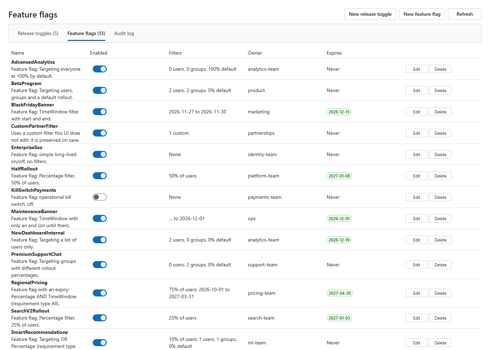
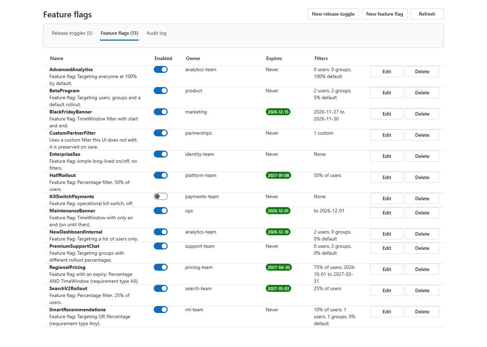
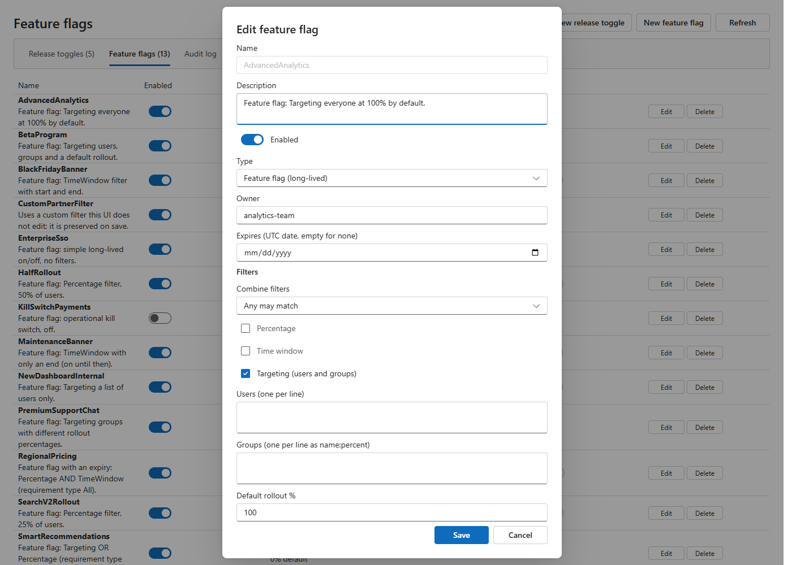

# FeatureManagement.UI

A drop-in admin page for [Microsoft.FeatureManagement](https://learn.microsoft.com/azure/azure-app-configuration/feature-management-dotnet-reference) flags, built with **Fluent UI 2**. It talks to a small REST API that stores flags through a pluggable provider (appsettings.json, SQL Server, Postgres, DynamoDB, AWS AppConfig or Azure App Configuration).

The same page ships as a React component and as a Blazor component, so it works in React, Blazor, MVC and Razor Pages apps.

## Fluent UI 2

[Fluent 2](https://fluent2.microsoft.design/) is Microsoft's cross-platform design system. This library uses its two web implementations:

| Host | Library | Docs |
|---|---|---|
| React | `@fluentui/react-components` (Fluent UI React v9) | <https://react.fluentui.dev> |
| Blazor, MVC, Razor Pages | `Microsoft.FluentUI.AspNetCore.Components` v5 | <https://www.fluentui-blazor.net> |

## Release toggles vs feature flags

| | Release toggle | Feature flag |
|---|---|---|
| Lifetime | Short; expires after **90 days** by default | Long-lived; no expiry by default |
| Options | On/off, owner, expiry | On/off, owner, optional expiry **and filters** |
| Filters | None (any filters are stripped on save) | Percentage, time window, targeting (users and groups with rollout percentages), combine with All/Any, plus custom filters preserved untouched |

Expired or soon-to-expire items are highlighted, and every change is recorded in an audit log. Updates use ETags to prevent lost writes.

## Screenshots

| React | Blazor |
|---|---|
|  |  |

| MVC | Razor Pages |
|---|---|
|  |  |

Editing in React:



## Repository layout

| Path | Purpose |
|---|---|
| `src/FeatureManagement.UI.Core` | Model, validation rules and admin service |
| `src/FeatureManagement.UI.Api` | Minimal API (`MapFeatureFlagAdmin`) |
| `src/FeatureManagement.UI.Providers.*` | Json, Sql (SQL Server and Postgres), DynamoDb, AwsAppConfig, AzureAppConfig |
| `src/FeatureManagement.UI.Blazor` | Razor class library with the Fluent UI Blazor page |
| `src/FeatureManagement.UI.React` | `@featuremanagement/ui-react` package |
| `samples/` | Aspire AppHost, ApiService, Blazor, MVC, Razor Pages and React samples |

## Try the samples

Requires the .NET 10 SDK and Node.js 20+.

```powershell
cd samples/Sample.React && npm install && cd ../..
dotnet run --project samples/Sample.AppHost
```

The Aspire dashboard lists the API service and all four UIs. The ApiService edits `samples/Sample.ApiService/appsettings.json`, which contains flags covering every toggle type and filter.

> The sample API allows anonymous access. Configure an authorization policy for real apps (see below).

## 1. Set up the API (all hosts)

Reference `FeatureManagement.UI.Api` and one provider project, then:

```csharp
using FeatureManagement.UI.Api;
using FeatureManagement.UI.Providers.Json;

builder.Services.AddFeatureManagement();                       // your normal flag evaluation
builder.Services.AddFeatureFlagAdmin(api =>
{
    api.AuthorizationPolicy = "FeatureFlagAdmins";             // or api.AllowAnonymous = true for local demos
});
builder.Services.AddJsonFeatureFlagStore(o =>
    o.FilePath = Path.Combine(builder.Environment.ContentRootPath, "appsettings.json"));

var app = builder.Build();
app.MapFeatureFlagAdmin();                                     // serves /api/feature-flags
```

Pick one provider:

```csharp
builder.Services.AddJsonFeatureFlagStore(o => o.FilePath = "appsettings.json");
builder.Services.AddSqlServerFeatureFlagStore(connectionString);
builder.Services.AddPostgresFeatureFlagStore(connectionString);
builder.Services.AddDynamoDbFeatureFlagStore(o => { /* table name, client */ });
builder.Services.AddAwsAppConfigFeatureFlagStore(applicationId, configurationProfileId);
builder.Services.AddAzureAppConfigFeatureFlagStore(new Uri(endpoint), new DefaultAzureCredential());
```

Optionally add a health check that fails on expired flags: `builder.Services.AddHealthChecks().AddExpiredFeatureFlagsCheck();`. See [docs/feature-flags.md](docs/feature-flags.md) for provider details.

## 2. React

```bash
npm install @featuremanagement/ui-react @fluentui/react-components react react-dom
```

```tsx
import { FluentProvider, webLightTheme } from "@fluentui/react-components";
import { FeatureFlagAdmin } from "@featuremanagement/ui-react";

export default function App() {
  return (
    <FluentProvider theme={webLightTheme}>
      <FeatureFlagAdmin baseUrl="/api/feature-flags" />
    </FluentProvider>
  );
}
```

`baseUrl` is the API route. Proxy `/api` to your API in dev (see `samples/Sample.React/vite.config.ts`) or enable CORS on the API.

## 3. Blazor

Reference `FeatureManagement.UI.Blazor` (it brings `Microsoft.FluentUI.AspNetCore.Components`).

`Program.cs`:

```csharp
builder.Services.AddRazorComponents().AddInteractiveServerComponents();
builder.Services.AddFeatureFlagAdminUi(new Uri("https://your-api/api/feature-flags/"));
```

`Components/App.razor` head:

```html
<link rel="stylesheet" href="_content/Microsoft.FluentUI.AspNetCore.Components/Microsoft.FluentUI.AspNetCore.Components.bundle.scp.css" />
```

`Components/Layout/MainLayout.razor`: add `<FluentProviders />`.

A page (it must be interactive):

```razor
@page "/"
@rendermode InteractiveServer
@using FeatureManagement.UI.Blazor

<FeatureFlagAdmin />
```

## 4. MVC and Razor Pages

Both host the Blazor component through Razor's component tag helper. On .NET 10 this needs the `blazor.web.js` script and the Razor Components endpoint, even though the app itself is not Blazor.

`Program.cs` (after `AddControllersWithViews()` or `AddRazorPages()`):

```csharp
builder.Services.AddRazorComponents().AddInteractiveServerComponents();
builder.Services.AddFeatureFlagAdminUi(new Uri("https://your-api/api/feature-flags/"));

var app = builder.Build();
app.UseAntiforgery();
app.MapRazorComponents<App>().AddInteractiveServerRenderMode();   // App is an empty component, see samples
```

Add an empty `Components/App.razor` (the sample files are empty), plus `_ViewImports` entries if needed.

In `_Layout.cshtml`:

```html
<link rel="stylesheet" href="~/_content/Microsoft.FluentUI.AspNetCore.Components/Microsoft.FluentUI.AspNetCore.Components.bundle.scp.css" />
<script src="~/_framework/blazor.web.js"></script>
```

In the MVC view or Razor Page:

```cshtml
<component type="typeof(FeatureManagement.UI.Blazor.FeatureFlagAdmin)" render-mode="Server" />
```

See `samples/Sample.Mvc` and `samples/Sample.RazorPages` for complete working apps.

## Consuming flag values

The admin UI only edits flags. Your apps read them through `Microsoft.FeatureManagement`, which evaluates release toggles and feature flags the same way. Each consuming app must load the same flag store the admin API writes to (for the JSON provider, the same `FeatureManagement` section of configuration; for Azure App Configuration, `builder.Configuration.AddAzureAppConfiguration(o => o.UseFeatureFlags())`).

```bash
dotnet add package Microsoft.FeatureManagement.AspNetCore
```

```csharp
builder.Services.AddFeatureManagement()
    .AddFeatureFilter<ContextualTargetingFilter>();   // needed for user/group targeting
```

### MVC controller

```csharp
public class CheckoutController(IFeatureManager features) : Controller
{
    // Returns 404 when the toggle is off
    [FeatureGate("NewCheckoutFlow")]
    public IActionResult Index() => View();

    public async Task<IActionResult> Banner()
    {
        var context = new TargetingContext { UserId = User.Identity?.Name, Groups = ["beta-testers"] };
        ViewBag.ShowBanner = await features.IsEnabledAsync("BlackFridayBanner", context);
        return View();
    }
}
```

In a view (add `@addTagHelper *, Microsoft.FeatureManagement.AspNetCore` to `_ViewImports.cshtml`):

```cshtml
<feature name="DarkModeBeta"><link rel="stylesheet" href="~/css/dark.css" /></feature>
```

### Razor Pages

```csharp
public class IndexModel(IFeatureManager features) : PageModel
{
    public bool UseNewSignup { get; private set; }

    public async Task OnGetAsync() =>
        UseNewSignup = await features.IsEnabledAsync("NewSignupPage");
}
```

Gate a whole page with `[FeatureGate("OrdersApiV2")]` on the `PageModel`, or use the `<feature>` tag helper in the `.cshtml`.

### Blazor

Register `AddFeatureManagement()` and inject the manager. Use `IFeatureManagerSnapshot` for a stable value per request in static rendering, or `IFeatureManager` in interactive components:

```razor
@inject IFeatureManager Features

@if (_search2)
{
    <SearchV2 />
}
else
{
    <SearchV1 />
}

@code {
    private bool _search2;

    protected override async Task OnInitializedAsync() =>
        _search2 = await Features.IsEnabledAsync("SearchV2Rollout", new TargetingContext { UserId = "alice" });
}
```

## Consuming flag values from React

Browsers should not read the flag store directly, and percentage and targeting rules are evaluated on the server. Instead, add an endpoint to your own API that evaluates flags for the current user, and have React fetch it. For example:

```csharp
app.MapGet("/api/flags/evaluate", async (IFeatureManager features, ClaimsPrincipal user) =>
{
    var context = new TargetingContext { UserId = user.Identity?.Name };
    var result = new Dictionary<string, bool>();
    await foreach (var name in features.GetFeatureNamesAsync())
        result[name] = await features.IsEnabledAsync(name, context);
    return result;
});
```

The sample API has a similar endpoint in `samples/Sample.ApiService/Program.cs`: `GET /api/demo/evaluate?user=alice&groups=beta-testers`. On the React side, load the evaluated values once and share them through context:

```tsx
import { createContext, useContext, useEffect, useState, type ReactNode } from "react";

const FlagsContext = createContext<Record<string, boolean>>({});

export function FlagsProvider({ children, url = "/api/flags/evaluate" }: { children: ReactNode; url?: string }) {
  const [flags, setFlags] = useState<Record<string, boolean>>({});
  useEffect(() => {
    fetch(url, { credentials: "include" }).then(r => r.json()).then(setFlags).catch(() => setFlags({}));
  }, [url]);
  return <FlagsContext.Provider value={flags}>{children}</FlagsContext.Provider>;
}

export const useFeature = (name: string) => useContext(FlagsContext)[name] ?? false;

export function Feature({ name, children }: { name: string; children: ReactNode }) {
  return useFeature(name) ? <>{children}</> : null;
}
```

```tsx
<FlagsProvider>
  <Feature name="NewCheckoutFlow"><NewCheckout /></Feature>
</FlagsProvider>
```

Unknown or failed flags default to off. Re-fetch on focus or on an interval if you want changes to appear without a reload. Always enforce the same flag on the server for anything security-sensitive; hiding UI is not access control.

## Tests

```powershell
dotnet test tests/FeatureManagement.UI.Tests
```
